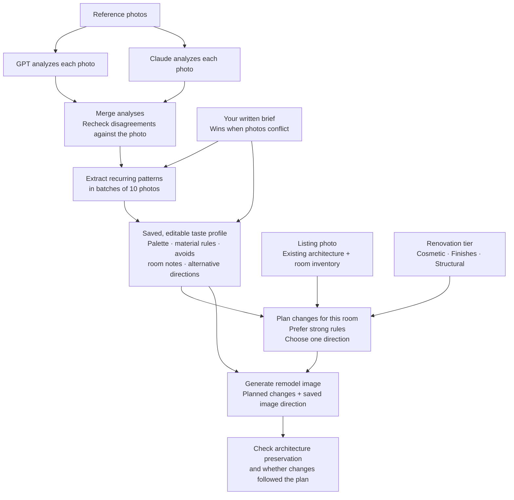

# Whim

Whim creates realistic listing-photo redesigns from your interior-taste
references. Each redesign is scoped to a budget tier and includes a report with
cost bands and checks for changes to fixed architecture. See [PLAN.md](PLAN.md)
for architecture and roadmap details.

## Get started

### Requirements

- Node.js 22 or newer and npm.
- API keys for OpenAI and Anthropic to use the default models. Image generation
  can use direct OpenAI or OpenRouter. You can start the local app without keys, but you need
  the required keys to rebuild taste rules or generate redesigns.

### Install and configure

From the repository root:

```bash
npm ci
npm run app
```

Open <http://localhost:4310> and choose **Settings** (bottom of the sidebar, or
the last tab on a phone). There you can:

- **API keys:** paste your OpenAI and Anthropic keys and check that each one
  works. Once saved, only the last four characters are shown.
- **Models:** pick the reasoning model, the reference analysis models, and the
  image model. **Image edits at once** controls generation concurrency (default
  6; choose 1–16).
- **Tuning:** set the edge-check threshold, score your past runs (no API
  calls), label images where the structure changed, and apply the suggested
  threshold.
- **Cost assumptions:** change the local labor factors, finish-grade
  multipliers, overhead, and any unit cost in the pricing table.

Settings are saved in `.settings.json` at the repository root, which git
ignores and only your user can read. They apply to the command-line tools too,
and override shell environment variables and env files. Clearing a setting
falls back to the shell environment, then `.env.local`, then `.env`, then the
built-in default. Changes saved in the app take effect without restarting it.

If you prefer files, copy `.env.example` to `.env.local` and add your keys:

```dotenv
OPENAI_API_KEY=your-openai-key
ANTHROPIC_API_KEY=your-anthropic-key
```

The defaults use OpenAI and Anthropic for reference analysis, OpenAI for
planning and checks, and OpenAI for image edits. To use OpenAI for all analysis
and planning, set these optional overrides in `.env.local`:

```dotenv
ANALYSIS_MODELS=openai/gpt-6.1-sol
REASONING_MODEL=openai/gpt-6.1-sol
```

You can change model IDs and image concurrency with the optional settings in
[`.env.example`](.env.example). Keep real keys in `.env.local`; never commit
them.

### Start the app

```bash
npm run app
```

Open <http://localhost:4310>. To use another local port, set `PORT` before
starting the app, for example `PORT=4320 npm run app`.

To open the app on another device, connect it to the same Wi-Fi network or
Tailscale tailnet. Find the Mac's Tailscale IPv4 address in the Tailscale app,
then open `http://<mac-address>:4310` on the other device. The app has no
sign-in, so only use it on a network you trust.

### Find your way around

The app opens on **Home**, with a reel of redesigned photos and the five most
recent reports. Click the Whim logo to return there. On a phone, the bottom bar
has **Home**, **Listings**, **Tastes**, **Reports**, and **Settings**.

Drag or swipe the reel to browse photos, or use its pause/play button to
control the automatic drift. Hovering or keyboard-focusing a photo brings it
forward and blurs its neighbors. With reduced motion enabled on your device,
the reel stays still until you browse it manually.

**Reports** collects reports across your listings, newest first. Each listing
also keeps its own past runs. The sun/moon switch follows your device's
appearance by default; a manual light/dark choice lasts for the current tab
session. The logo and favicon adapt to the selected mode.

## OpenRouter image models

In **Settings → API keys**, save and check an OpenRouter key. Under **Models**,
choose **Image provider → OpenRouter**, select **FLUX.2 Klein 4B** or **FLUX.2 Pro**,
then **Save models**. For another image-editing model, choose **Other model ID**
and enter its OpenRouter slug, such as `black-forest-labs/flux.2-klein-4b`.
Reasoning and reference analysis also offer OpenRouter options: Qwen3.8 27B,
Mistral Small 3.2 24B, and Qwen3 VL 235B A22B. These accept photo inputs and
structured output. OpenRouter models use their provider default thinking settings;
the effort slider applies only to supported direct-provider models. Choose them
independently of the image provider. Current defaults remain OpenAI/Anthropic.

The adapter sends the source photo first, then revision references, through the
[OpenRouter Image API](https://openrouter.ai/docs/guides/overview/multimodal/image-generation).
It checks endpoint capabilities before generation, enforces reference limits,
chooses the closest supported aspect ratio, and normalizes outputs to PNG. It
uses 1K when a resolution control is supported; otherwise the provider default
applies. FLUX Klein accepts four images total, including the source and any pin
markup. Generation is prompt-based without a mask. Existing architecture checks
and automatic quality retries still apply.

The selected route is recorded with each run; revisions retain that model even
after Settings changes. CLI configuration uses
`IMAGE_MODEL=openrouter/black-forest-labs/flux.2-klein-4b` and `OPENROUTER_API_KEY`.
The in-app dollar estimates remain approximate constants, not OpenRouter billing.
Compare using the same photos, scopes, and profile, for example:

```bash
npm run tune -- compare listings/your-listing --models gpt-image-2.5-sunburst,openrouter/black-forest-labs/flux.2-klein-4b --profile profiles/your-profile/profile.json --tiers cosmetic --max 3
```

This comparison makes paid calls to both providers.

## Create a taste profile

1. In **Taste profiles** (**Tastes** on a phone), open **Example** or use
   **New taste profile** to create a profile.
2. Add at least 3 interior reference photos you like; 10–20 gives the models
   more to work with. JPG, PNG, WebP, and TIFF are supported. Near-duplicates
   are skipped.
3. Write a brief describing your preferred styles, materials, colors, rooms,
   and things to avoid. Be specific about the materials and details you want.
4. Choose **Rebuild rules**. The app combines the brief with analysis of your
   references. You can then edit the rules, image direction, and room notes in
   the app.

The app saves the profile in `profiles/<id>/`. You can rebuild its rules from
the command line with:

```bash
npm run taste -- --profile example
```

### How the taste pipeline works

A rebuild turns reference photos and your written brief into a saved, editable
profile. Redesigns apply that profile to each room within the chosen renovation
tier. The diagram shows the default two-model analysis; `ANALYSIS_MODELS` can
configure a different set, including a single model that skips the merge step.



Each rule records how many distinct reference photos support it and whether
your brief states it. A rule is **strong** when it comes from the brief, or when
at least 25% of the photos support it, rounded up, with a minimum of two photos.
For 20 references, a rule seen in 5 photos is strong; a rule seen in 1 photo is
weak; a rule stated in the brief is strong even with no photo evidence. These
counts are model-derived evidence, not measured confidence. Planning prefers
strong rules and uses weak rules only where no strong rule applies.

The profile also captures room-specific notes and, when supported, alternative
directions such as earthy or playful. Planning chooses one direction per room
and adapts it to the existing architecture and allowed work. Image generation
receives the listing photo, planned changes, and saved image direction and
room notes; it does not receive the taste reference photos directly.

Changing references or the brief marks the profile as out of date; **Rebuild
rules** updates it. You can also edit and save the rules directly. A rebuild
replaces those edits but keeps the previous profile available to restore.
Keep category rules, image direction, and room notes consistent because they
guide different stages of the redesign.

Implementation: [taste pipeline](src/taste/pipeline.ts),
[taste prompts](src/taste/prompts.ts), [redesign planning](src/redesign/plan.ts),
and [image generation](src/redesign/generate.ts).

## Add a listing

In the app, choose **New listing** on Home or beside **Listings**, enter a name
and optional location, then choose **Add photos** or drop photos onto the
listing. Label rooms (for example, `kitchen` or `den`), choose which photos to
redesign, select a taste profile, and choose the budget tiers: **Cosmetic**,
**Finishes**, or **Structural**.

Use **Done** to collapse the photo grid into a stack; click the stack to show
the grid again. Smaller screens show fewer whole thumbnails, and the stack
reserves room for its hover fan so it stays clear of neighboring controls.

You can also import photos from a local folder using the CLI. Replace the
example path, ID, and name with your own:

```bash
npm run import -- ~/Pictures/123-main-st --id 123-main-st --name "123 Main St"
```

The importer accepts JPG, PNG, WebP, and TIFF files, corrects photo rotation,
resizes large images, skips near-duplicates, and adds new photos as selected.
Reload the app to see the listing. You can also import individual files by
passing their paths instead of a folder.

Listings and their selections are stored in `listings/<id>/`. To add more
photos to an existing listing, use **Add photos** or run the import command
again with the same ID.

## Generate a redesign

In the app, open the listing, select the photos and taste profile, and check
at least one renovation scope. Scopes start unchecked unless the page URL
already includes a scope selection. **Run redesign** stays disabled until you
choose a scope.

The app shows the number of redesigns and an approximate duration before you
start: five selected photos across two scopes produce ten redesigns. Choose
**Run redesign**, review the confirmation, then choose **Start run**. The report
opens when the run finishes. Each room includes before-and-after images by
tier, a change list with cost bands, and a verification status.

Each photo's selected scopes run in parallel after its room inventory is
complete. The app shares the **Image edits at once** limit across running
listings; separate CLI processes each have their own limit. An image that
fails the architecture check is regenerated once with feedback, which adds
API calls. Wait for active runs to finish before restarting the app.

To share a report with someone who won't open the app, use **Summary PDF** or
**Full scope PDF** at the upper right of the report. Both are landscape, so each
listing photo and its redesign sit side by side at a readable size. **Summary**
(about four pages) has the whole-listing estimate per scope, a before-and-after
for every room, the largest costs, and what to check. **Full scope** adds every
scope of every room with both photos large, what to check, and every planned
change with what it replaces and how it was priced.

You can also run the saved listing selection from the CLI:

```bash
npm run redesign -- listings/123-main-st --profile profiles/example/profile.json --tiers cosmetic,moderate
```

Add `major` to `--tiers` for speculative layout changes. Reports and run data
are saved under `.runs/`. API calls can incur charges; each run processes the
selected photos across the chosen tiers, and rebuilding a profile analyzes its
reference photos.

| Status | Meaning |
|---|---|
| Verified | Fixed elements (windows, doors, stairs, ceiling) passed both the edge check and the vision judge. |
| Needs review | The judge passed, but an edge shifted near a fixed element or the plan was only partly followed. |
| Unverified | The architecture checks still failed after a retry. Review the reported problems before relying on the image. |

## Spot changes

To change one room without re-running the whole listing, open its report in the
app and click a redesign image. The inspector opens with a **Changes** panel
beside the image that works like a chat: type a change, use **Pin** to click
spots on the image and add a note to each (each pin is matched to the item
under it), and optionally add **Context** and up to three reference
**Photos**. Enter sends it. A change starts from the version on screen, so
click any earlier version in the conversation to branch from it. It revises
that plan, redraws that image, and checks the result against the listing photo
and each pin; the reply shows the new version when it's done. **Use in report**
picks the version the report, totals, and PDFs use. Versions are saved in the
run folder as `versions.json` plus one folder per version, and the run's
original results are never changed. Each change costs about $0.15 of API use.

From the CLI (pins are 0–1000 from the image's top-left):

```bash
npm run change -- .runs/redesign/123-main-st/<run> photo_01 moderate "warmer white oak cabinets" --pin "400,120=smaller brass pendant"
```

## Tune verification

After a few real runs, check how well the edge check separates good images from
broken ones and how the image models compare:

```bash
npm run tune
```

This re-scores every saved image under `.runs/redesign/` without any API calls
and writes `.runs/tuning/report.md`. The report sweeps edge thresholds from
0.20 to 0.70, suggests the one with the best balance of caught failures and
false alarms, shows the correlation range per element type, and compares image
models by verdict and retry rate. Apply a suggested threshold with
`EDGE_THRESHOLD` in `.env.local`.

By default the vision judge's structural call is treated as the right answer.
Your own judgment is better. To label images yourself:

```bash
npm run tune -- labels
```

Open `.runs/tuning/labels.json`, set `label` to `"ok"` or `"broken"` for the
images you've looked at (each entry lists the original and redesign paths), and
run `npm run tune` again. Re-running `labels` adds new images and keeps your
labels.

To compare image models on the same photos, redesign one listing once per
model. This makes API calls for every model, and the CLI prints an estimate
first:

```bash
npm run tune -- compare listings/123-main-st --models gpt-image-2,gpt-image-2.5-sunburst --profile profiles/example/profile.json
```

Runs from before this change don't record their image model and show as
`unknown` in the model comparison.

## Your data and privacy

Listings, profiles, reference photos, and run artifacts are stored in this
checkout. Personal listings, profiles, and runs are gitignored; only the empty
`profiles/example/` starter profile is shared in the repository. When you
rebuild rules or generate a redesign, the relevant reference or listing photos
and prompts are sent to the configured model providers for processing. Do not
use photos or details you are not comfortable sending to those providers.
Whim does not scrape listing sites; source listing photos yourself.

## Configuration

Saved app settings take precedence over the shell environment, `.env.local`,
and `.env`, in that order. Env files live in the repository root.
`.env.example` lists the optional overrides; the defaults are:

| Setting | Default | Purpose |
|---|---|---|
| `OPENAI_API_KEY` | — | Required for image edits and default OpenAI models. |
| `ANTHROPIC_API_KEY` | — | Required by the default analysis models. |
| `ANALYSIS_MODELS` | `openai/gpt-6.1-sol,anthropic/claude-sonnet-5-5` | Models that analyze each taste reference. |
| `REASONING_MODEL` | `openai/gpt-6.1-sol` | Planning, rule extraction, and verification. |
| `IMAGE_MODEL` | `gpt-image-2.5-sunburst` | Image-edit model. |
| `IMAGE_CONCURRENCY` | `6` | Maximum image edits in flight per process, shared across app listings. Set 1–16 with **Image edits at once** in Settings; lower it if OpenAI rate-limits. |
| `EDGE_THRESHOLD` | `0.45` | Minimum edge correlation for a fixed element to pass. See [Tune verification](#tune-verification). |
| `PORT` | `4310` | Local app port. |
| `HOST` | `0.0.0.0` | Listener address. Use `127.0.0.1` for localhost-only previews or access exclusively through a local proxy. Set this in the shell when starting the app. |
| `ALLOWED_HOSTS` | — | Additional exact hostnames accepted by the server, comma-separated, without scheme or port. For Tailscale Serve, add the mini's full `.ts.net` hostname in `.env.local` and restart. |

## UI motion and layout

The app and reports use shared theme tokens and visual primitives in
`src/ui/design-system.css`, embedded in standalone exports. See the
[design-system guide](docs/design-system.md) for component ownership and verification.

The app and generated HTML reports use the locally installed
[Motion](https://motion.dev/docs/animate) bundle. The animation code is embedded
in generated reports, so it works when the HTML is opened from disk without
loading an animation library from a CDN. Report photos still live alongside
the HTML in the run folder.

[The shared runtime](src/app/motion.js) owns timing, interruption, reduced
motion, and cleanup when a view is removed. [The bundle loader](src/motion.ts)
supplies the same runtime to the app and [report renderer](src/report.ts).
CSS `--motion` declarations in the app and report styles specify properties
and durations for hover, focus, pressed, and selection feedback. Use
`whimMotion.animate()` or `whimMotion.sequence()` for coordinated interactions
such as photo-grid expansion, dialogs, progress bars, and report tabs.

Native Motion CSS animations handle transforms, opacity, and the reel's bokeh
filters. Motion also handles CSS variables and numeric values; the reel uses
its shared frame loop. Continuous motion pauses when the tab is hidden, and
reduced-motion preferences apply to ongoing animations and loading spinners.

Photo stacks reserve their full hover footprint at rest. Listing stacks use
container queries to show whole thumbnails that fit the panel; report previews
leave space between the expanded fan and the report action. Keep continuous
movement on transforms and measure layout outside the frame loop rather than
animating thumbnail margins.

After changing the shared runtime or bundle loader, restart the app and reload
the page. Wait for active redesigns or taste rebuilds to finish before
restarting.

## Development checks

```bash
npm run check
npm test
```

### Image performance

App reports use responsive WebP previews; the image viewer keeps the full original
for zooming and editing. Preview derivatives and prepared generation inputs are
cached in `.runs/.image-cache/` and reused after restarts. The memory cache is
limited to 32 MiB, and simultaneous conversions of the same image share one job.
Source changes invalidate previews. This cache is disposable and regenerates on
demand; it does not replace listing photos or generated originals.

New redesign runs write per-stage wall times to `timings/` inside the run folder,
including preparation, inventory, planning, generation, and verification. Generation
times include waiting for an API slot and retries. These measurements do not reduce
AI image quality or change the report's PDF export behavior.
